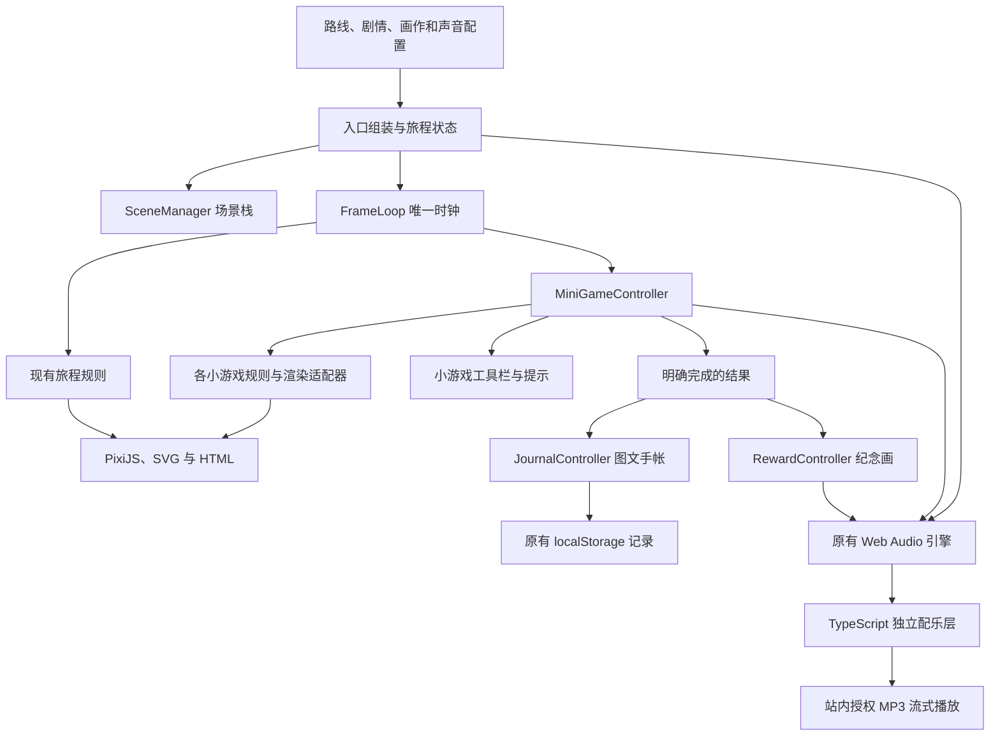

# 山径的运行架构与 TypeScript 迁移

本轮从 GitHub `codex/recover-site` 的 `b292790` 开始，该提交对应版本 40。下面描述重构后的源码架构；**已完成集中验证并推送 Git，随后用户批准原站点整合发布**。验证记录见 [runtime-refactor-verification.md](runtime-refactor-verification.md)，后续发布准备见 [audio-runtime-release.md](audio-runtime-release.md)。

## 源码与发布目录

```text
src/
  app.js                          浏览器入口：组装模块、旅程和地图显示
  runtime/
    contracts.ts                  路线、手帐、小游戏、素材、音效的共享类型
    dom.ts                        DOM 边界和可释放的事件绑定
    scene-manager.ts              场景栈、暂停、返回、后台状态
    frame-loop.ts                 唯一动画时钟及取消
    mini-game-controller.ts       小游戏进入、输入、更新、重试、退出
    mini-game-view.ts             各类小游戏的工具栏、提示和进度显示
    reward-controller.ts          纪念画展开、收起、焦点、收藏过渡
    journal-controller.ts         标签墙、图文详情、翻页与自动保存
    music-layer.ts                武功山/莫干山免费主题、流式切换与暂停清理
    mogan/                        莫干山注册适配器、规则和共用水彩场景描述
    index.ts                      公共入口及类型导出
scripts/
  build-runtime.mjs               TypeScript 编译、浏览器打包
dist/
  runtime.js                      从 src/runtime/ 生成，请勿直接编辑
  app.js                          从 src/app.js 生成，请勿直接编辑
  index.html / *.css              现有页面和水彩风格
  journey.js / journal.js / …     暂时保留的 JavaScript 规则与画面模块
  vendor/ / scenes/ / sprites/ …  原有 PixiJS、图片、声音与许可
```

这是一轮真实的渐进迁移：公共控制器采用 TypeScript，启用 `strict` 和 `noEmitOnError`；旅程规则、地形绘制、具体小游戏规则与 Web Audio 引擎仍保留原 JavaScript 实现。没有将旧文件简单改后缀，也没有使用 `@ts-nocheck` 或 `any` 跳过新控制器的类型边界。

## 运行关系



`app.js` 保留路线选择、旅程状态的组装、地图坐标、角色与环境绘制、打卡照片和音频场景选择。小游戏输入、独有工具栏、手帐阅读和保存、纪念画展示已移到各自控制器，不再同时放在主程序里。迁移后的入口也整理为可阅读的源码；这是一轮职责拆分，不是下载体积或帧率优化。

版本 41 之后的新武功山音效工作加入 `createMusicLayer`，通过入口依赖注入交给旧引擎。四个小游戏独立选用免费署名配乐，当前游戏和对应奖励持续同一音轨，进入其他游戏时等新流就绪再淡出旧流；只缓存四种已知主题，切后台或退出会暂停全部。短音效仍由 Web Audio 缓存/调度。设计与许可见 [wugong-music-design.md](wugong-music-design.md)，本轮独立验证及发布状态见 [wugong-free-audio-release.md](wugong-free-audio-release.md)，不继承下文重构阶段的验证结论。

莫干山三段现通过 `createMoganGames` 注册到公共控制器。新接雨与石阶规则在 `mogan/rules.ts`，弹弓继续使用旧规则；`scene-model.ts` 统一生成两个渲染路径的物件与遮罩描述，`scene.ts` 管理 PixiJS/SVG 和资源，`adapter.ts` 管理三段控件。适配器可自行处理坐标、按键、控件及进入时天气，不将专用分发加回主循环。实现见 [mogan-route-upgrade.md](mogan-route-upgrade.md)；本轮 85 项相关测试、两种浏览器尺寸与原生音频通过，具体范围及真机/听感限制见 [mogan-route-release.md](mogan-route-release.md)。

### 场景与时钟

- 场景包括照片、小游戏、奖励与手帐，每次进入获得独立 session。退出一个过时 session 不会关闭新场景或恢复其旅程。
- 控制器支持手帐叠在小游戏上；关掉手帐返回原游戏，不推进徒步进度。现有游戏面板会遮挡标签墙入口，未增加游戏内手帐按钮；嵌套状态由规则／DOM 检查和浏览器中的程序化入口激活验证，不能据此声称该入口已通过指针可达性验收。
- 切后台将所有待返回状态改为暂停。重新聚焦不会因为收起旧弹窗而意外恢复行走。
- 统一 `FrameLoop` 提供秒数 `dt`，限制单帧跨度。暂停、切场景和退出时清除时间基准，避免返回后补跑后台时间。
- PixiJS 仍由外部时钟显式绘制，不启用额外独立 ticker 推进游戏。

### 小游戏边界

`MiniApi` 对既有 `TrailMicroMoments` / `TrailMiniGames.enhance()` 提供类型边界：

| 接口 | 职责 |
| --- | --- |
| `create` | 创建初始状态 |
| `act` / `move` / `release` | 处理点击、拖动和释放 |
| `tick` | 推进规则，产生完成状态和声音事件 |
| `draw` / `paint` | 创建和更新画面 |
| `instruction` / `status` | 返回操作提示和即时反馈 |
| `outcome` | 返回真实完成结果 |
| 可选 `assets` / `mount` / `dispose` | 供新适配器接管素材和渲染器生命周期 |

控制器统一处理鼠标、触摸、键盘、取消拖动、重试、声音事件去重、素材加载状态与旧异步结果失效。现有玩法通过原适配层接入，保留拼图正向放置、拨云、拍照、接雨、推叶、消除和弹射规则。

新增独立规则可实现 `MiniApi`，再通过控制器的 `registerGame([画作ID], adapter)` 接入，避免继续往 `app.js` 添加分发分支。已有小游戏的独有工具栏集中在 `mini-game-view.ts`；新类型需要专用工具栏时，在该 UI 模块扩展。旧 `mini-games.js` 内部仍有历史分发逻辑，并未宣称所有旧模块已经迁移完毕。

### 完成、纪念与手帐

只有 `state.play.complete === true` 才允许向入口发送完成结果。入口使用原发现规则确认这次捕获，手帐控制器调用原去重规则保存，奖励控制器展示纪念画。奖励控制器本身不生成记录或判定胜利。

保留原有存储 key、记录版本、画作 ID、首次文字与日期。重玩去重、旧记录升级和存储不可用提示继续使用原规则。没有加入导入、导出、清空或自动删除功能，也不改写浏览历史时的数据。

## 开发与构建

```bash
npm ci
npm run build
python3 -m http.server 8000 --directory dist
```

首次拉取需要开发依赖；玩家访问网站时不需要 Node.js。`npm run build` 用 TypeScript 编译实际的运行模块，再用 esbuild 打包浏览器脚本。两个产物保留在 `dist/`，便于现有静态托管和源码恢复。它不启动浏览器、不执行测试，也不发布站点。

修改 `src/` 后运行必要构建生成浏览器代码。`dist/` 下其余未迁移模块仍是现行源码，不要删除。上线仍沿用原 Sites 项目和访问范围。

TypeScript 的严格模式及 esbuild 构建选项参考[TypeScript 官方说明](https://www.typescriptlang.org/tsconfig/strict.html)与[esbuild 官方构建 API](https://esbuild.github.io/api/#build-api)。锁定开发依赖版本：TypeScript 5.9.3、esbuild 0.25.12；PixiJS 保持 8.22.0。

## 验证与限制

用户批准后完成资源／语法检查、265 项既有自动回归及 3 项新生命周期检查。首轮 3 个旧音效断言失败，修正后定向复测通过；没有重复跑全套。构建已启用严格类型检查，未额外重复独立 `typecheck`。

实际 Chromium 在 1280×900、390×844 两种尺寸完成武功山四项小游戏、奖励与保存，另检验手帐往返、接雨重试、退出清理及声音生命周期。完整范围、首次失败、探针修正和原始结果都记录于 [验证说明](runtime-refactor-verification.md)。

实体手机、人工试听及真实硬件性能仍待验收，其他路线所有小游戏的真实浏览器完整通关也未覆盖。重构先按用户要求完成验证并推送 Git，之后用户批准将音效与最新架构一并上线试听；实际发布状态以 Sites 返回为准。
