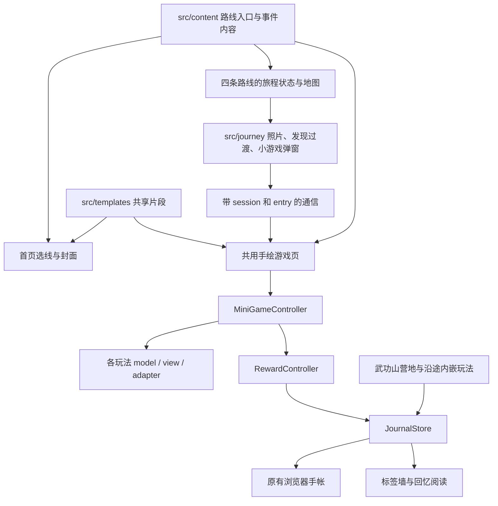

# 共用组件与内容边界整理 · 2026-10-21

本轮按用户要求提高抽象与复用。保留 2D 示意地图、Q 版人物、各路线原有玩法和手帐数据，不更换引擎，不发布。现有工作区包含此前未提交的麦理浩径和全国选线工作，均继续保留。

## 当前边界

### 内容

- `src/content/catalog.ts` 定义四条独立旅程的入口、封面文案和手绘页地址。首页不再以多段路线判断复制这些信息。
- `content/{wugong,tiger,aotai,maclehose}.ts` 保存事件身份与地点文案；地图与 `art-events.ts` 使用同一来源。手绘页根据关卡身份确定收藏地点，不接受 URL 中任意指定的地点。
- 路线顺序、触发距离、支线与过夜续程仍由各路线的 `journey.ts` / `chapter.ts` / `route.ts` 管理。武功山事件描述与路径上的触发位置分离。
- 照片文件、作者和许可仍留在各路线的 `photos.ts`；三条路线共用 `PlacePhoto` 展示契约。尚未把所有地标、老游戏素材目录和照片表统一成一个总表。

### 旅程界面

- `journey/photo-dialog.ts` 已接入虎跳峡、鳌太线、麦理浩径，统一显示、重试、署名、加载失败、关闭和过期回调失效。旅程只提供地点和关闭后的续程行为。武功山保留其专用 `VisitView`。
- `journey/art-overlay.ts`、`discovery-transition.ts`、`visible-motion.ts` 由四条路线复用。原来从武功山目录导入的共用代码已迁移，归档试片的引用同步更新。
- `art-session.ts` 定义 `trailbound.art.v1` 协议。一次打开分配一个随机会话号，同时关联关卡 ID；消息还需通过原有的来源窗口与 origin 检查。关闭、收藏、就绪和销毁都使用同一协议。过期会话或其他关卡的消息不能推进当前旅程。
- 四张主地图和共用小游戏页使用 `FrameLoop`，路线帧跨度上限保持 50 ms；暂停会取消待执行帧并重置计时。`journey/viewport.ts` 统一尺寸观察及退出时的取消。

### 绘制和输入

- `runtime/projection.ts` 提供 `createProjection` 和 `coverCamera`。四张地图、海岸互动及登高望海的画面与点击逆变换共用这一实现。鳌太线保留横纵不同的地图缩放比例，各路线仍独立决定地形取景。
- 用户随后要求统一地图可用高度、人物屏幕大小与跟随平滑度。四条新路线已接入 `journey/map-camera.ts` 和 `dist/journey-map.css`，不再分别维护镜头插值与人物补偿缩放；实现和专项检查见 [shared-map-camera-2.md](shared-map-camera-2.md)。
- 坐标约定：模型和路径使用场景坐标；`toScreen` / `toWorld` 使用画布所在容器的局部像素；DOM 边界负责把指针位置换算到该容器。设备像素比只影响画布清晰度。
- `MiniApi.input: 'direct'` 显式声明直接操作画面的能力；`soundTheme` 单独声明声音主题。沙滩画笔和登高望海已迁移，不再在规则状态里伪装成 `creek` 或 `footsteps` 才能获得输入、重试和声音控制。
- 旧游戏仍走兼容分支，避免这次重构扩大成全部玩法重写。

### 手帐

- `runtime/journal-store.ts` 是共同的读写入口：首页手帐控制器、四路线的游戏页以及武功山营地/沿途收藏均使用它。
- 每次保存先重新读取浏览器记录，再使用原有去重与升级规则合并；重复游玩保留第一次的文字、日期及画作。未完成不写入，容量不足或写入失败返回错误。
- 首页奖励也使用相同的保存结果：失败显示重试，不宣称收藏成功。手帐视图不再先把未保存的记录加入收藏墙。
- 保存格式和 key 沿用原实现，没有清空、迁移、删除、导入或导出旧记录。
- 这是同步 localStorage 合并，解决长期挂载页面持有旧快照的问题；**不保证不同浏览器标签在同一瞬间写入的事务原子性**。本轮未引入 IndexedDB、跨标签锁或云端账号。

### 构建

- 首页源码现在是 `src/templates/home.html`。
- `mini-panel.html`、`journal-wall.html`、`memory-overlays.html` 是首页及四个手绘页共同使用的片段。
- `scripts/build-pages.mjs` 生成首页；`build-wugong-art.mjs` 直接读取片段，不再根据首页元素字符串截取内容。
- 共用游戏页入口为 `src/journey/art-page.ts`。继续输出 `dist/wugong-art.js` 以保留原有 URL；该文件名不表示只供武功山使用。
- 开发监听补入 HTML 模板和相关构建脚本。`dist/` 中尚未迁移的地图 HTML、CSS 和旧 JS 仍是源码，不可整体删除或覆盖。

## 实现与验证状态

- 已完成源码迁移和调用方接入。
- 已执行必要构建，TypeScript 编译和浏览器打包完成。构建不代表交互、手机、GPU 或声音验收。
- 新增 `shared-journey.test.cjs`、`photo-dialog.test.cjs`，覆盖保存合并/失败、旧会话失效、照片重试/关闭、动画取消、投影逆变换。相关旧测试已随接口迁移。
- 用户已授权本批集中验证，并明确只检查武功山、虎跳峡、鳌太线和麦理浩径四条新线路。旧线路留待后续迁移，本批不验收其旅程页面。
- 第一轮运行 150 项相关逻辑/模拟 DOM 检查，147 项通过；3 项失败来自接口返回字段和统一地点名后的旧断言。已更新断言，重跑受影响的 26 项全部通过。四条路线的完整浏览器验收尚未全部完成；后续地图专项检查不能替代全部小游戏、过夜与支线验收，历史结果不作为本批证据。

本批验证范围：四条新路线进入/退出照片和小游戏；自动入帐、保存失败重试和首次记录保留；切后台后无补跑；虎跳峡支线与过夜、鳌太线多程过夜、武功山清晨衔接；麦理浩径两段显式直接输入玩法；手机与桌面的绘制/点击坐标一致。旧线路、归档 3D 试片和全素材重新验收均不在本批范围内。
