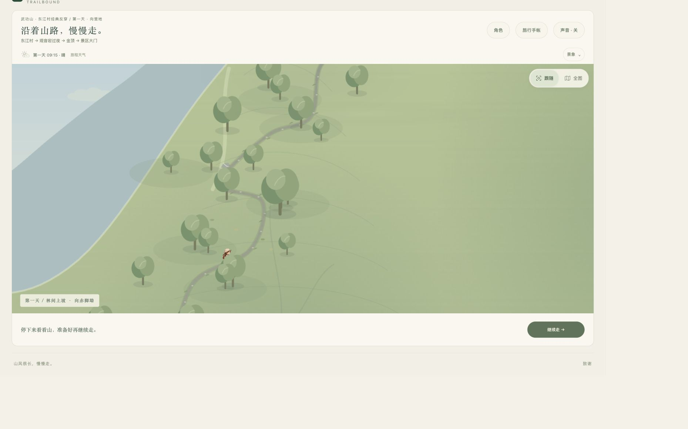
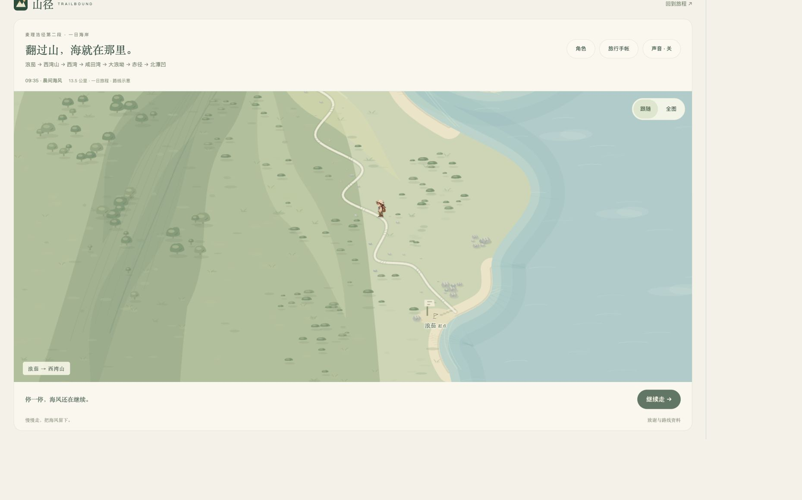

# 四条新路线的共用地图呈现 · 2026-10-21

用户要求统一地图可用高度、人物屏幕大小和跟随平滑度，并继续抽取可复用组件。本批接入武功山当前 `scroll/` 主线、虎跳峡、鳌太线和麦理浩径。旧路线留待后续迁移；未提交、推送或发布。

## 实现

| 共用组件 | 职责 |
| --- | --- |
| `src/journey/map-camera.ts` | 默认跟随、画面投影、镜头过渡、全图切换、尺寸变化和减少动态效果 |
| `mapCharacterScale()` | 抵消镜头两个轴的缩放，统一人物屏幕大小，保持原来的脚底锚点 |
| `src/characters/metrics.ts` | 记录角色素材既有的 54 单位站立高度基准 |
| `dist/journey-map.css` | 四张地图共用高度及横竖屏规则 |

跟随时人物站立高度约 40 CSS 像素，全图约 20 CSS 像素，切换时连续变化。步态和坐姿仍使用原素材比例，不按每帧轮廓重新拉伸；鳌太线地图纵横比例不一致时，人物仍保持原比例。武功山落脚修正同步考虑缩放后的足底位置。

镜头采用相同的时间平滑响应，位置、缩放和人物高度使用同一过渡进度。插值作用于完整的屏幕投影，避免分别平滑世界中心与缩放造成切换中途人物滑出画面。尺寸变化与减少动态效果立即取景；输入逆变换与实际绘制使用同一份投影。

路线继续提供自己的目标取景：武功山向山路前方看、虎跳峡兼顾脚下金沙江、鳌太线保留山脉全景比例、麦理浩径保留海岸构图。地理、行进顺序、小游戏、照片和手帐数据未在本批改写。

地图高度使用稳定视口单位 `svh`：桌面 `clamp(420px,66svh,780px)`，窄屏 `clamp(420px,64svh,700px)`，矮横屏 `clamp(260px,72svh,420px)`。移除四条路线重复的高度规则，以及鳌太线切到全图后单独缩短高度的规则。跟随／全图仍在地图右上角，默认跟随。

## 验证

沿用用户已经限定为四条新路线的测试授权，集中检查本次地图改动。

- `npm run build` 完成 TypeScript 编译与浏览器打包。
- 首轮运行 `map-camera`、`aotai-camera`、`wugong-schematic-trip`、`maclehose-turning`、`shared-journey`，30 项通过。
- 浏览器中发现全图返回跟随时人物短暂滑出画面，修复完整投影的过渡方式并增加回归用例；定向重跑共用镜头与武功山相关 16 项，全部通过。未无理由重跑全套游戏。
- 共用镜头检查覆盖不同地图倍率、横纵不等比投影、30/60/120 帧率、逐步缩小人物、暂停帧、减少动态效果、尺寸变化和绘制／输入坐标往返。
- 本批已跟踪文件的差异空白检查通过。整个工作区的 `git diff --check` 仍提示此前 `src/tiger-walk/route.ts` 与 `src/wugong-walk/scroll/discovery-transition.ts` 各有一个末尾空行；本批未顺带改写这两处既有差异。

真实内置浏览器读取四张地图的 DOM 尺寸如下，每组四条路线结果一致，均无横向溢出：

| 实际 CSS 视口 | 地图可用宽高 | 路线数量 |
| --- | --- | --- |
| 1636 × 1023 | 1571 × 675 | 4 |
| 443 × 959 | 422 × 614 | 4 |
| 959 × 443 | 894 × 319 | 4 |

浏览器设置的测试尺寸为 1440 × 900、390 × 844、844 × 390；受现有浏览器缩放影响，实际 CSS 尺寸为上表记录值，不能写作实体手机尺寸。

通过界面操作检查四条路线的默认跟随、全图往返、出发及暂停／到达后取景，并观察人物落脚。武功山、虎跳峡和麦理浩径各走一段后暂停；鳌太线行进至白起庙实拍，关闭照片后检查跟随取景。四条路线本次读取的浏览器错误日志均为空。鳌太线全图与跟随保持相同容器高度。

本批不是全部旅程重新通关，也未验收实体手机、声音或硬件性能。人物比例与镜头观感仍可由用户在预览中确认。

原始日志位于 `.local/verification/shared-camera-2/`，截图位于 `docs/previews/shared-camera-2/`。

