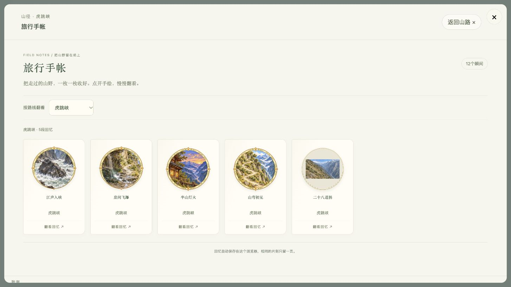

# 虎跳峡徽章 · 形状与边缘核对

后续：用户已确认按规范实施统一圆形、边缘与大小，并授权集中检查；当前实现、实际页面检查和测试限制见[虎跳峡圆形手帐徽章统一](tiger-paper-badges-1.md)。下文仅保留改动前的源码与素材依据，用户对新审美的认可另行记录。

2026-10-22。依据用户反馈“有的不是圆形，有的没有边缘设计”，读取现有源码、查看本地徽章素材与已保存截图。**本轮只完善文档，没有改图、改运行代码、读取玩家当前存储或执行浏览器测试。** 制作标准见[旅行手帐徽章规范](journal-badge-design-guide.md)。

## 已确认的问题与范围

四张现行固定底图都是圆形画心加装饰框，不能笼统判断为“四关都缺圆框”。实际存在两类不统一：旧记录的矩形画心与新圆形画心混在一起；新底图的亮金粗边、外凸尖饰和透明余量也不符合本次提出的统一纸边基准。

“没有边缘”的具体收藏项尚未定位。本轮看到的四张现行底图均有边框，动态合成源码也保留了边框；不能据此否定用户实际看到的缺边，也不能把尚未复现的原因写成已确认故障。后续需在获准的浏览器验收中核对具体事件 ID、保存图片及奖励／收藏墙／详情显示差异。

## 四张现行底图

文件均位于 `dist/badges/tiger-memories-v4/`。以下判断来自逐张查看本地图片；未进行像素测量或运行游戏。

| 事件与徽章 | 素材／最终来源 | 现状 | 后续调整建议 |
| --- | --- | --- | --- |
| `tiger-bends-puzzle-v4` · 山弯初见 | `bends.webp`，固定画作 | 圆形有框；金边和四个尖饰明显，外缘接近画布边界 | 用连贯的山径转弯与深江谷形成主构图，收敛亮金和尖饰，统一圆外留边 |
| `tiger-inn-pairs-v4` · 半山灯火 | `inn.webp`，固定画作 | 圆形有框；窗灯与暮色可辨，边框同样偏亮 | 保留窗灯作为暖色重点，减少边框抢眼，保持完整纸环 |
| `tiger-waterfall-paint-v4` · 崖间飞瀑 | `waterfall.webp` 底框＋本次涂色捕获 | 底图有框；瀑布和沿崖小径可辨，圈外可见零散色点 | 保留玩家涂色，用公共画心几何和纸边合成，清理圈外残点 |
| `tiger-river-roundframe-v4` · 江声入峡 | `river.webp` 底框＋本次取景捕获 | 底图有框；外圈带尖饰，巨石与白浪是主体 | 保留当时取景，边框最终覆盖，统一完整圆形和干净透明边界 |

当前素材由 `scripts/art/prepare-tiger-memories.mjs` 将设计板等分为四张 `627 × 627` 图片。脚本保留原图 alpha，不校正每枚实际可见圆的直径、中心、尖饰或圈外残点。因此相同文件尺寸不能作为“大小和边缘已统一”的依据。

母版与原提示词在 `art/tiger-games-design-v4/`，处理记录在 `dist/scenes/tiger-memories-v4/credits.json`。原提示词本就要求象牙色金边及四向小饰；后续调整时须同步更新设计来源，不能只更换分发图。

## 已找到的矩形画心

历史截图 `docs/previews/tiger-trip-8/journal.jpg` 中，前四枚新版是圆形风景画，旧版“二十八道拐”则是一张矩形画放在米白圆底中。

这是既有截图，用于说明确实存在的表现，不是本轮实时浏览器结果。

对应实现为 `src/runtime/journal-badge.ts`：

- `roundJournalArt()` 只对有限的 `ROUND_BADGE_IDS` 进行兼容，其中含 `tiger-28-bends-v1` 与 `tiger-middle-river-frame-v1`。
- 对虎跳峡旧画启用 `preserveFrame: true`，将完整矩形按比例缩进圆形区域，再在外围画纸边。原画内容保住了，但圆形画心没有铺满。
- 当前四个 v4 事件不在该集合中，展示依赖它们自己的底图或已保存捕获。已有转换不构成覆盖全部历史画作的统一方案。

旧图“保全内容”与“圆形构图”需要分别处理。建议逐项确认可用的圆形展示构图，原件继续可读、存储不改写；若裁切会损失玩家作品或关键主体，先保留旧画作并记录兼容例外。不得直接用新版固定徽章覆盖旧收藏。

## 动态画作与缺边待查项

`src/runtime/tiger-memories/view.ts` 当前捕获顺序是先画 `576 × 576` 底图，再在中心半径 `249` 的圆内绘制瀑布涂色或江边取景。`adapter.ts` 只为这两关将捕获结果作为 `captureArt` 返回；前两关入帐使用固定底图。

这说明当前意图是保留原边框，不能把“缺边”直接归因为没有绘制边框。需要继续核对：

1. 用户看到的是旧事件、四个现行事件，还是较早保存的捕获图。
2. 捕获圆与美术底图的实际内缘是否吻合；底图如果换了半径，硬编码的裁切是否会覆盖纸边。
3. 完成展示、奖励、收藏墙与详情是否都使用同一画作；是否有旧缓存或历史捕获绕过了边框。
4. 边缘是实际缺失，还是过浅、太细、贴边裁切或被背景吞掉。需同时看浅色纸页和较深奖励背景。

后续应让画心、边框和裁切来自共同几何，采用“先内容、最后纸边”的合成顺序，并明确素材是否已经带框。这里只记录实施方向，未修改现有合成。

## 建议的修复顺序

1. 先用虎跳峡一枚固定画作和一枚玩家创作确定纸边样式：低饱和灰金、完整米白纸环、无外凸尖饰，圆外余量一致。
2. 将确认的纸边与几何接入公共徽章能力，四关同时采用；保留每关独立画心与玩家结果。
3. 单独处理旧矩形记录的展示兼容，保护原作、ID、日期与首次文字，不自动覆盖收藏。
4. 按授权集中检查四关真实完成、自动入帐、淡出与重玩，以及旧收藏、不同屏幕和图片失败。

本轮产物为规范与问题清单。新徽章画稿、公共边框改造、历史画作兼容及实际体验验收均未完成，不能标为“虎跳峡徽章已修复”。
