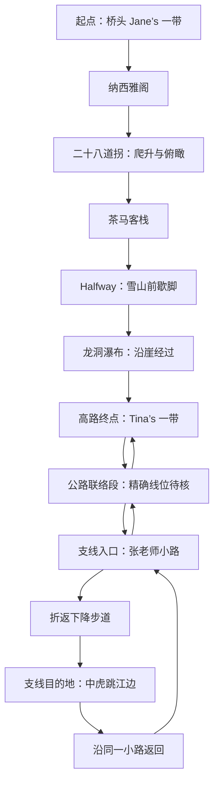

# 虎跳峡：从高路走到金沙江边

状态：用户已授权「使用 PixiJS 基于设计完成代码」，本地实现进展与边界见 [tiger-pixi-implementation.md](tiger-pixi-implementation.md)。本稿保留设计依据；构图、时长与手感尚未经体验验收。用户已确定「保留高路，增加中虎跳江边支线」，要求地标真实、玩法直观有趣，并给每段旅程明确的起点和终点。

**整段体验围绕一次尺度变化展开：沿高路爬升，俯瞰金沙江；再下到中虎跳江边，看巨石旁的激流从脚下远景变成眼前主角。** 虎跳峡的江是金沙江，属于长江上游。半山雪峰、客栈与瀑布负责丰富旅途，江流与深峡是整体的视觉中心。[虎跳峡地理概述](https://en.wikipedia.org/wiki/Tiger_Leaping_Gorge)

本稿替代旧的四段景深排序、背包收纳、八拍声景、循铃找路方案；此前的寻景、翻牌、打砖块、迷宫设想也不作为本稿实施内容。旧实现和旧收藏暂时保留，不因设计更新自动迁移。

## 1. 路线先成立，互动再落位

采用现有历史高路轨迹的范围：桥头 Jane’s 一带出发，到 Tina’s 一带结束高路。原始记录作者说明自己的往返起点、折返点分别是 Jane’s 和 Tina’s；这支持本作选择的范围，并不表示所有现实徒步都采用这两个端点。[原始路线与 GPX 说明](https://fastestknowntime.com/route/tiger-leaping-gorge-yunnan-china)

高路的主要顺序是纳西雅阁、二十八道拐、茶马客栈、Halfway，再向龙洞瀑布与高路出口行进。不同徒步者会采用不同出口和住宿点；本作保留原 Tina’s 终点，再补上通往支线入口的联络关系。[高路现场记录](https://www.thegonegoat.com/china/hiking-the-tiger-leaping-gorge-china)、[Halfway—龙洞—出口记录](https://thehiddenchina.com/tiger-leaping-gorge-hiking-guide/)

以下为**顺序示意，不是比例地图**。箭头不代表已取得精确路径坐标。

张老师小路的入口经过张老师客栈，现场记录支持通过折返步道下行并沿原步道返回。Tina’s 与张老师客栈应作为两个地点处理，公路连接段尚未完成精确定位。[入口与往返依据](https://thefabryk.com/blog/tiger-leaping-gorge-hike)

天梯是另一条上下线路；一线天可继续通往下游核桃园。本轮采用原路往返，二者不拼入必经线路。中虎跳江边的观景场景也不借用上虎跳景区的观景台或石景。[支线关系](https://en.wikivoyage.org/wiki/Tiger_Leaping_Gorge)、[下游延伸线路](https://www.asia-hikes.com/yunnan-china-tiger-leaping-gorge/)

### 真实地点与设计角色

| 地点 | 应让玩家记住什么 | 本作安排 | 资料边界 |
| --- | --- | --- | --- |
| 桥头 Jane’s 一带 | 从谷口进入这条高路 | 出发旗与路线开场 | 历史轨迹起点不等于已核准的建筑门口 |
| 纳西雅阁 | 正式爬升前的沿途节点 | 路标与短暂经过 | 不是新增的大型景观关卡 |
| 二十八道拐 | 折返爬升后，江流落到更深的谷底 | 第一段主要操作 | 做代表性连续路段，不声称逐弯复原全部 28 弯 |
| 茶马客栈 | 爬升后的途中落脚点 | 轻量路标，经过可停 | 不在这里硬塞收纳游戏 |
| Halfway / 中途客栈 | 阳台朝向玉龙雪山的山间停留 | 自由看景和歇脚 | 以现场视角为依据，不泛称任意中途路标 |
| 龙洞瀑布 | 山崖、流水与小径近距离交会 | 短场景过渡 | 名称、流路与设施年代需要一致的参考组 |
| Tina’s 一带 | 高路收束，接入江边支线 | 清楚展示两条旅程的关系 | 与张老师客栈分开定位 |
| 中虎跳江边 | 巨石、白浪、峡谷岩壁，近距离感受金沙江 | 全程视觉高潮与第二段主要互动 | 具体站位、石体轮廓、流态需用同一地点影像核对 |

二十八道拐、Halfway 阳台看玉龙雪山也是现场报道中明确出现的记忆点。[新华社现场报道](https://www.xinhuanet.com/20240622/620b9e431462474a8835225edcce6355/c.html)

## 2. 玩法节奏：两段重点，中间留出旅途

建议首轮完整体验约 4–6 分钟，其中主动操作约 1–2 分钟；这是制作目标，不是实测。玩家可停留更久，也可跳过互动继续走。主线经过不等于获得画作，跳过也不产生收藏。

| 段落 | 主要动作 | 节奏与反馈 | 手帐规则 |
| --- | --- | --- | --- |
| 二十八道拐 | 沿小径带小人爬升 | 转弯收近引导，直路放开；登上后展开峡谷 | 完成连续路段后，主动收下纪念画 |
| Halfway | 坐下、看看山，再起身 | 视线从近栏杆移向玉龙雪山，给上一段留余韵 | 单纯停留不新增收藏 |
| 龙洞瀑布 | 经过水与山径交会的位置 | 近处水声与岩壁遮挡短暂包围人物，再露出峡谷 | 本版不设独立闯关和奖励 |
| Tina’s—江边 | 选择进入支线，随步道下降 | 江流变宽、白浪变清晰，声音逐步靠近 | 到达本身不自动发画作 |
| 中虎跳江边 | 追随白浪取景，留下自己的画面 | 流动、构图与选择组成主互动 | 实际拍摄、选择并确认留下后才生成一条记录 |
| 返回 Tina’s | 沿原支线返回 | 回望江谷，旅程在原接入点收束 | 返回不重复弹奖，不伪造另一条下山线 |

### A. 二十八道拐——一步一步，江在脚下

**一句话操作：按住小人，沿山路带他往上走。**

进入时先看到可走小径、人物和前方一个弯。首次触摸出现一小段水彩脚印，松手即停；不弹规则面板。手指在人物前方引导，人物逐步走过去。指向距离影响步速，转急弯时收近引导更容易，直路可以放开走。

乐趣来自连续过弯和逐渐升高的视野。人物有转身、脚步和短暂收步，镜头跟随但不会把转弯藏在屏幕外。每走高一段，山壁遮挡自然退开，金沙江在谷底露得更多；不按每弯发分数，也不人为增加岔路。

判定以人物实际走过的连续路径为准。拖到终点不能瞬移，跨过山壁不能跳段。引导离开小径时，人物在上一个有效位置停步，脚印提示回到路上；不坠落、不扣生命、不退回整关。触控容差按画面尺寸扩大，手指可在路边附近引导，不要求描细线。

代表性路段走完、人物抵达上方终点后，镜头展开俯瞰峡谷的构图。玩家主动收下「二十八道拐 · 江在脚下」。建议操作 25–40 秒，长度以实际手感调整。需重点证明它有转弯和速度反馈，而不是重复描线。

两次点击也可操作：点人物，再点当前可达的一小段小径；人物走到目标停下。键盘提供同等短程移动。每种输入都受相同路段边界约束。

### B. Halfway 与龙洞——让风景自己占据画面

Halfway 使用具体阳台的视角：近处木栏与桌椅、对面的山体和雪峰，中间有峡谷纵深。人物坐下后可轻拖视线，随后主动起身继续。不给茶杯、背包或按钮增加无意义的完成次数。

龙洞以「小径经过山崖流水」为核心。现场历史影像确有流水越过小径的关系；设施可能发生改建，制作前应选择一致的参考年代，确定是否呈现步道、护栏等构筑物。现有宽幅瀑布图只作风格参考，不能直接当成已核准的地形。[历史现场照片与步道关系](https://www.jennyfaraway.com/tiger-leaping-gorge-yunnan/)

本版不再增加第二套沿路拖动游戏。人物经过、流水遮挡与声音靠近组成短过场，玩家可停下观看。删去八拍谱格、人工时机门和独立通关；把制作精力集中在后面的金沙江。

### C. 中虎跳江边——跟着一道白浪，留下奔流的一刻

**一句话操作：拖动取景，跟着白浪拍下你喜欢的一刻。**

抵达时先把完整峡谷和江面交给玩家：近岸站位、江中巨石、被分开的流线、岩壁之间的狭窄天空。相机只在这个观景位置调整视线和有限焦段，不在各岸之间瞬移。

玩家拖动取景范围，观察白沫经过巨石附近时的方向变化。可以追着一段白浪移动，也可以把巨石和江面一起放进画面。这里的白沫是水流的一部分，不是需点亮的目标、收集物或悬浮提示点。

按快门拍下当前画面；按住快门可短暂连拍，松开后看预览，从中选一帧，确认「留下这一刻」。重拍会返回同一站位。连拍是可选创作方式，单张拍摄同样完整；没有标准构图、唯一浪峰时刻或必须等满的计时条。

照片应真正保存当次构图、浪花状态与所选画面。第一次进入时的默认画面、只移动视线、只观看都不自动完成。记录的核心是玩家明确拍摄并选择的作品，不给跟踪时长或镜头移动距离打分。

这里的操控乐趣是预判可见的水流、移动取景与选片。若原型只是拖静态背景，或拍下的仍是同一张固定徽章，就没有达到本稿目标。具体绕流、白浪及可能的回流必须来自选定视角的真实影像；未核实的漩涡不成为规则。建议停留和操作 30–60 秒，也允许自由看更久。

完成后水彩纸边轻轻显出，保留刚刚选择的画面，收进「中虎跳江边 · 奔流的一刻」。人物仍站在观景位置，再由玩家选择返回。返回沿同一条已走过的路径，可压缩行进动画，不再重复爬升小游戏。

## 3. 画面比例与声音

### 从高处到江边，尺度连续变化

| 视角 | 构图重点 | 首稿建议 |
| --- | --- | --- |
| 二十八道拐 | 前景小径与人物、崖壁遮挡、下方细长江流 | 江面位于画面低处，人物不压住路径；通过爬升揭示纵深 |
| Halfway | 栏杆提供近景尺度，玉龙雪山和峡谷占主体 | UI 留在边缘，桌面道具不占据大半幅画 |
| 龙洞 | 近崖流水与经过的小径，远处仍可辨峡谷 | 瀑布尺度和山径关系依参考重画，不泛化成正面大瀑布 |
| 中虎跳江边 | 大片动水、巨石、向上延伸的岩壁 | 江面约占场景一半可见面积，巨石与白浪关系清晰，人物为尺度参照 |

上述占比是构图目标，不是改变真实地形比例的理由。游戏应让峡谷占据主体，但角色和操作对象仍有稳定的可读尺寸。

桌面场景使用窗口扣除简短页头后的主要宽高，宽屏通过补充两侧绘景扩展视野，核心画面统一等比缩放；不能把 16:9 背景直接横向拉宽，也不能只放大图片导致端点出屏。手机单独构图：江面和山壁纵向展开，人物、巨石、快门留在可触达区，避免整张桌面画缩成小窗。图形、命中范围和镜头使用同一变换。

沿用精细水彩、纸纹与自然色层。用同一季节和光照的照片组确定植被、水色、山体与流量；金沙江既不能因为名称被画成恒定金黄，也不应统一画成静止的碧蓝湖面。以实际中虎跳站位校对河流方向和岩石轮廓，完成这一步之后再出正式分层素材。

声音从高路的风与脚步，逐渐转向江边宽阔、低频更明显的水声。靠近激流时降低背景音乐存在感，不靠骤然放大总音量表现壮观。只使用许可清楚的免费素材；通用急流录音标明为游戏声景。静音时白浪速度、方向、飞沫和视觉反馈足以理解互动。未进行人工试听，不能写成音效已验收。

## 4. 起点、终点和支线在地图上怎么表示

主地图进入时先展示整条高路的起点旗「桥头 · 高路起点」与终点旗「Tina’s · 高路终点」。节点用实际地名，诗意标题留在进入场景后。固定地标不随每次游玩随机偏移。

到达 Tina’s 时，已完成高路。此处可以结束，也可以进入用户选定的中虎跳支线；支线有自己的「Tina’s · 支线出发 / 返回点」和「中虎跳江边 · 观景目的地」。江边到达旗表明下行阶段完成，返程箭头指回 Tina’s。返回后收束整段旅程，避免把地图终点标在途中又让人物继续漫无目的地走。

地图上同一地点只用一个地理锚点。Tina’s 的高路终点与支线角色合并成一个可展开标签，不堆两面重叠旗。出发、到达、返回用文字和形状区分，不能只用颜色。

支线按行进方向显示去程／返程；新节点需先取得位置证据。当前没有支线 GPX，设计图可表达连接关系，但不能把虚线随手连到江边后作为精确路线发布。小屏标签允许错开，用引线指回原地理锚点。

## 5. 数据与旧手帐的实施约束

当前地点失真的原因不只是名称：`dist/routes.js` 的几个检查点按 `.25/.5/.75` 放置；`dist/discoveries.js` 在旧自然事件的 `.055/.325/.77` 位置合入新地点名称，并带随机触发偏移；`src/app.js` 又用路线进度计算图标位置。把「峡谷眺望」改名成真实景点，不能修复这些坐标关系。

下一版需把三件事分开：真实地点锚点、可触发该场景的路段、允许偏移显示的 UI 标签。最低数据应有 `placeId`、`routeLeg`、位置或路段、来源、核验状态、参考视角；资料未齐时坐标为 `null`，不拿固定百分比填充。可随机发生的虚构邂逅另建事件，不能覆盖固定地标。

现有高路数据是历史 GPX 的去程截取，数据字段记录 `rawPointCount: 2517`，简化后 771 点、约 21.801 km；原始作者路线为往返记录，本轮未重新统计原始 GPX 文件。当前截取终点来自与起点距离最远点，不自动等于 Tina’s 门口。原始经纬度为 WGS84，端点如下，仅作追溯：

- 起点：`[100.0519283, 27.1859388, 1820.9]`
- 截取终点：`[100.157685, 27.2574499, 2074.7]`

支线加入后重新计算分段距离；未核准前不展示一个伪精确的全程公里数。不得把不同坐标系的地图点直接混入轨迹。

新玩法建议新 ID：`tiger-28-bends-v1`、`tiger-middle-river-frame-v1`。旧 `gorge-goat`、`gorge-eagle`、`gorge-sparkle`、`tiger-bell-first` 的首次日期、文字和画作照常保留，不能被解释为玩家已经走过新支线。相同新互动重玩仍只显示一条手帐，同等完成状态保留首次作品。可重拍当次尚未收藏的照片，不能借重玩覆盖历史记录。

## 6. 制作顺序与尚缺资料

1. **先完成地理底稿。** 核准高路地标位置、历史截取终点与 Tina’s 的对应关系，以及 Tina’s—张老师小路—江边的联络段和支线轨迹。用同一来源基准检查路径顺序、河岸和坐标系。
2. **先画最重要的江边场景，再反推高路构图。** 选定中虎跳观景站位和一致的影像参考，确定巨石、流向、岩壁与人尺度。高路的远江与这里的近江应让玩家认出是同一条河。
3. **制作两段操作与地图衔接。** 完成二十八道拐连续带路、江边真实取景选片、Halfway 歇脚、龙洞短过场，以及支线往返和起终点标识；不受旧四画作数量限制。
4. **实现完成后再按项目约定询问测试。** 建议届时集中验证触屏／鼠标、不同画幅、沿途节点顺序、跳过与返回、照片持久化、旧手帐兼容、暂停和退出。当前没有执行测试或浏览器验收。

已确认主要地点顺序及可选上下线路的关系；本稿选用张老师小路原路往返，Tina’s 至入口的具体连接待核。**尚缺精确地标坐标、可靠支线线形以及中虎跳固定站位的成组美术参考**。这些会阻止制作最终地理地图，但不影响本稿确定玩法方向。龙洞步道与江边设施存在不同年代记录，现有旅行文章对开放状态也不一致；仅将可追溯现场材料用于游戏场景设计，不推断当前开放情况。

设计阶段曾仅保存本稿。后续 PixiJS 实现与构建状态另记于实施文档；当前仍未测试、未提交、未推送、未发布。
